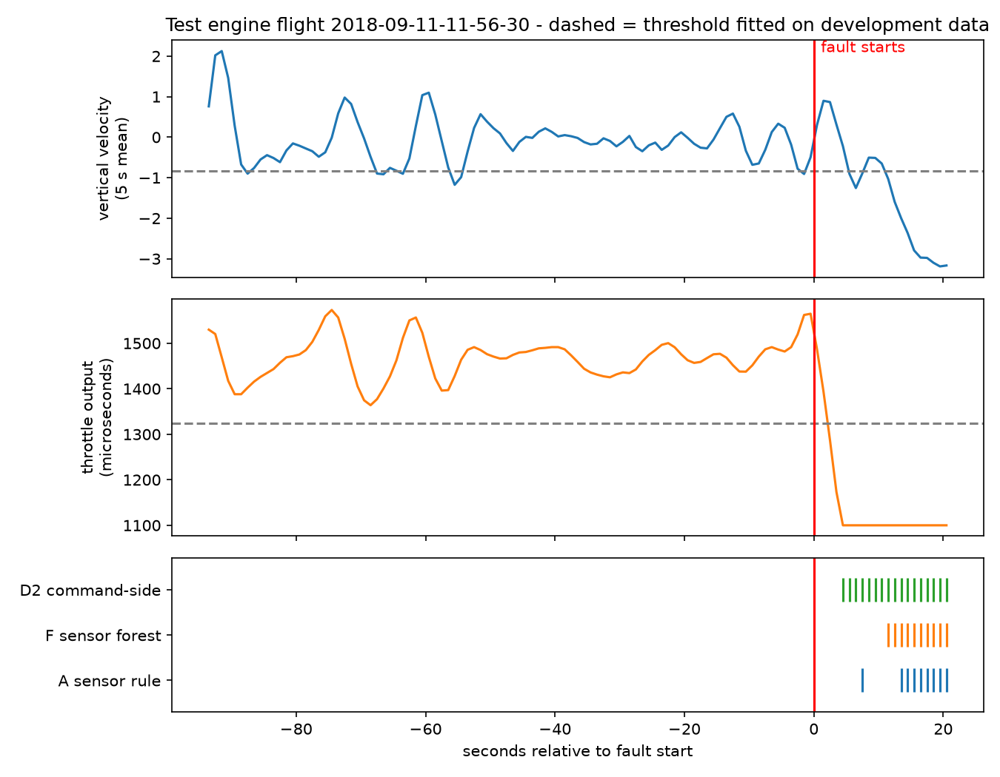
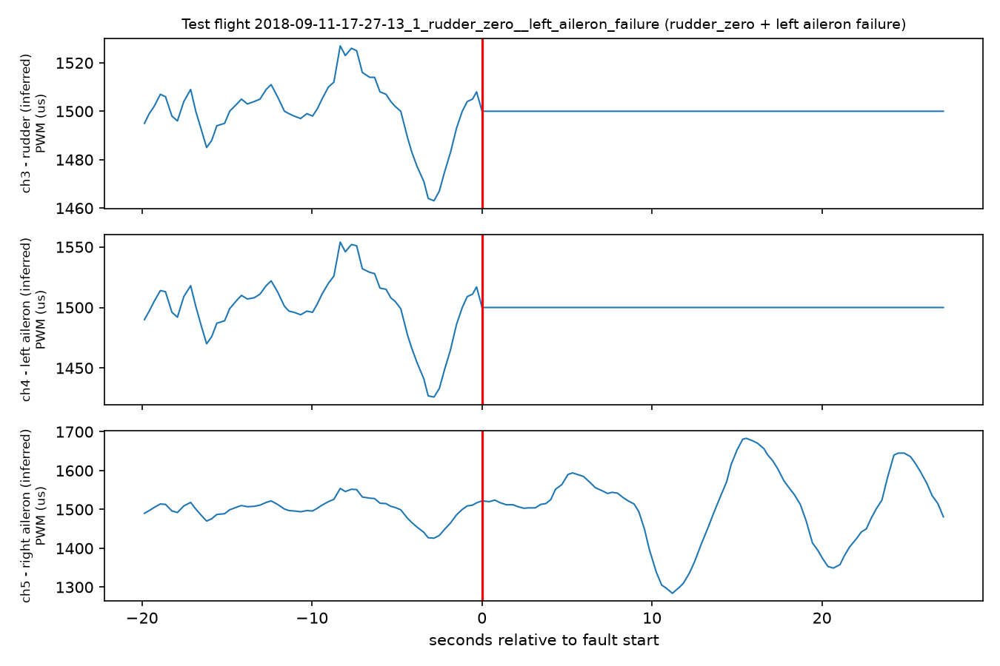

# Fault detection on real UAV flights (ALFA dataset): sensors vs. command channels

Detects the start of injected faults (engine failure and control-surface faults) in real flights of a fixed-wing UAV,
one second at a time, using only data from the past. Three detectors are compared on a locked test set, and the
project documents a data leak that makes the task look much easier than it is.

## Summary

- **Sensor-only detectors** (a one-feature rule and a random forest) reliably detect **engine** faults (5/5 test flights,
  median delay about 5 s) but are weak on aileron, rudder and elevator faults.
- **A command-side detector** (a frozen control channel, or a throttle cut) catches **every** fault type
  (8/8 test fault flights, F1 0.87, median delay about 3 s) and also says which surface failed.
- **Why that is not a fair win:** in ALFA the recorded servo commands (`rc-out`) already contain the injected fault.
  A frozen channel *is* the injection. This detector is therefore a ceiling that shows how easy the task becomes when
  the injection is visible, not a detector that would work on a real aircraft. The sensor-only result is the honest one.

## Data

[ALFA: A dataset for UAV fault and anomaly detection](https://doi.org/10.1184/R1/12707963) (CMU AirLab, CC BY 4.0).
47 processed flights of a fixed-wing UAV with sudden engine failures and control-surface faults, with ground-truth
fault times. One flight has no ground truth and is excluded, leaving 46. The data is **not** included in this repository.

Fault onset = first timestamp of the `failure_status-*` topics. Those topics are used only to build the label and are never
a model input.

## Evaluation design

- **One row per second**, built from trailing windows only (no future data): 5 s mean, 5 s standard deviation and
  10 s change for each signal. Sensor signals: altitude error, cross-track error, altitude, vertical velocity, and
  roll / pitch / yaw gap (measured minus commanded, angles wrapped to +/-180 degrees).
- **Splits by recording session**, so flights from the same session never end up on both sides. 9 flights were locked
  as a **test set** before any model was trained (5 engine, aileron, rudder, elevator, 1 normal). The other 37 flights
  were used for 5-fold session-grouped cross-validation.
- Only the **first 30 s after the fault** are scored as fault. Accuracy is not used (always predicting "normal" is right
  about 81% of the time). Reported instead: precision, recall, F1, false-alarm seconds per minute, flights detected,
  detection delay, and a **pre-fault control** (alarms in the 20 s before the fault, which show the chance level).
- An alarm needs **3 seconds in a row** (the frozen-channel feature already contains a 3 s window).

## Detectors

| Name | Inputs | Rule |
|---|---|---|
| **A** sensor rule | sensors only | one threshold on the 5 s mean vertical velocity, fitted on development data |
| **F** sensor forest | 21 sensor features | random forest, class-balanced, threshold 0.5 |
| **D2** command-side | `rc-out` channels | any of channels 1, 3, 4, 5 frozen for 3 s, OR throttle output below a fitted level |

Channel meaning is **inferred** from the data and flight names (the dataset README does not document it):
channel 1 = elevator, 2 = throttle, 3 = rudder, 4 / 5 = left / right aileron.

## Results

Development = 5-fold cross-validation on 37 flights. Test = 9 locked flights, scored once.

| Detector | Dev F1 | Test F1 | Test precision | Engine flights alarmed | Other-fault flights alarmed | False alarms (s/min) | Median delay (s) |
|---|---|---|---|---|---|---|---|
| A sensor rule | 0.48 +/- 0.18 | 0.46 | 0.90 | 5/5 | 1/3 | 0.44 | 5.1 |
| F sensor forest | 0.51 +/- 0.16 | 0.50 | 1.00 | 5/5 | 2/3 | 0.00 | 5.2 |
| D2 command-side | 0.85 +/- 0.09 | 0.87 | 0.98 | 5/5 | 3/3 | 0.26 | 3.1 |

No detector raised an alarm in the 20 s before the fault on any test fault flight. Test F1 is close to development F1
for all three, so the estimates did not collapse on unseen flights. An anomaly detector (isolation forest trained on
normal data only) was also tried and was clearly worse (dev F1 0.12 to 0.26), so it is not part of the final comparison.

**Fault isolation (D2, test set):** 94 of 119 flagged fault seconds named the right surface. Aileron (28/28),
elevator (8/8) and engine (58/58) were all right. The rudder flight scored 0/25 because it is a dual-fault flight
(rudder + left aileron): both channels 3 and 4 froze, but the rule outputs a single label. The evidence was correct;
the one-label rule could not express two faults.

## What the data revealed

1. Faults show up as **frozen command channels**: the affected output holds a constant value (often neutral, 1500
   microseconds) from the fault onset. Mean-level tests missed this for aileron faults because a surface frozen at neutral
   looks normal on average. Spread (variance) tests found it.
2. Because the injection is visible in the commands, a detector that reads them is not a physical detector. Separating
   "sensor-side" from "command-side" detectors is the main contribution of this project.

## Limitations

- Small data: 46 flights, **one flight per non-engine fault type in the test set**, and only about 21 s of normal flight
  in the test set, so false-alarm rates there are weakly measured. No confidence intervals.
- Some design choices (the 3 s freeze definition, the channel choice) were made after looking at the development flights,
  so development scores are slightly optimistic.
- D2 reads the injected command and would not transfer to a real aircraft. Channel meanings are inferred.
- One aircraft type and one dataset; no check on other platforms.
- The forest threshold (0.5) was not tuned.

## Repository layout

- `src/` - the pipeline: `01_build_table.py`, `02_make_split.py`, `03_command_features.py`, `04_final_test.py`,
  `05_figures.py`, plus `evalkit.py` (shared evaluation code) and `config.py` (paths).
- `experiments/` - the exploration and ablation scripts in the order they were run (signal screening with a placebo
  control, baselines, supervised and anomaly models, the frozen-channel investigation). They still contain the original
  absolute paths and are kept as a record of the investigation, not meant to run as they are.
- `figures/` - the plots above.

## How to run

1. Download the ALFA processed data from the DOI above and unzip it so that the flight folders are in
   `<data folder>/alfa/processed/processed/carbonZ_*`.
2. `pip install -r requirements.txt`
3. Set the data folder: PowerShell `$env:ALFA_DATA = "C:\path\to\data"` (default: `data/` inside the repository).
4. Run `src/01_build_table.py`, `02_make_split.py`, `03_command_features.py`, `04_final_test.py`, `05_figures.py` in order.

## Credits

Data and tools: Keipour, Mousaei and Scherer, "ALFA: A dataset for UAV fault and anomaly detection",
*International Journal of Robotics Research* 40(2-3):515-520, 2021, https://doi.org/10.1177/0278364920966642
(CC BY 4.0). The dataset is not redistributed here.
