# ALFA fault detection: full documentation

Project owner: Pham Anh Hoang. Last updated 2026-11-10. This file merges the project documentation, the setup lesson and the formula reference into one page. It is a work in progress and is updated as the project grows. The code line numbers are in [code_index.md](code_index.md).

## Contents

- [Part 1. Project documentation](#part-1-alfa-fault-detection-project-documentation): overview, the key points that trip people up, data and pipeline, results, mistakes
- [Part 2. Setup and handoff lesson](#part-2-alfa-fault-detection-setup-and-handoff-lesson): run the project on a new Windows PC
- [Part 3. Every number and formula](#part-3-alfa-fault-detection-every-number-and-formula): symbols, formulas, and a figure by figure explanation with the code

## Find the explanation of a figure

| Figure | What it shows | Explanation, formula and code |
|---|---|---|
| Fig1 | one engine flight and three detectors | [Part 3](#fig1-one-engine-flight-and-three-detectors) |
| Fig2 | raw command channels around the fault | [Part 3](#fig2-raw-command-channels-around-the-fault) |
| Fig3 | recall by fault type | [Part 3](#fig3-recall-by-fault-type) |
| Fig4 | confusion matrix | [Part 3](#fig4-confusion-matrix) |
| Fig5 | alarm timeline per fault flight | [Part 3](#fig5-alarm-timeline-per-fault-flight) |
| Fig6 | which features duplicate each other | [Part 3](#fig6-which-features-duplicate-each-other) |
| Fig7 | which features move with the fault | [Part 3](#fig7-which-features-move-with-the-fault) |
| Fig8 | model comparison | [Part 3](#fig8-model-comparison) |
| Fig9 | calibration | [Part 3](#fig9-calibration) |

---

## Part 1. ALFA fault detection: project documentation

### Overview

This project detects injected faults in fixed-wing drone flights from the public ALFA dataset (Carnegie Mellon University). The question is simple: can a model raise an alarm soon after an engine or control-surface fault starts, without too many false alarms during normal flying? It was built step by step as a learning and portfolio project, and every script is meant to be understood line by line.

On the locked test set (9 flights) the F1 scores were 0.46 for a one-feature sensor rule (detector A), 0.50 for a random forest on sensor features (F), and 0.87 for a rule that reads the command channels (D2). D2 is a ceiling, not a fair competitor, because it reads the channels where the injected fault itself shows up.

Most of the later work asks how far those numbers can be trusted. On the development folds the forest, CatBoost and a small neural network score F1 0.51, 0.54 and 0.53. The gaps between models are smaller than the spread between folds (0.35 to 0.78), so no model is declared the winner. A conformal-style alarm threshold, four sanity checks and a small API are covered in the sections below.

The code is public at https://github.com/PhamAnhHoangg/alfa-fault-detection. The dataset is not redistributed; it has to be downloaded from its source (see the setup lesson).

### Read this first: the key points that trip people up

These are the ideas that cost the most time when learning this project. They are ordered by how much damage a misunderstanding does to the results, worst first.

| Key point | What it means | Example | The mistake it leads to |
|---|---|---|---|
| 1. Split by session, not by row | Rows from one flight are near copies of each other | Neighbouring seconds share 4 of 5 seconds in their 5-second mean | A high score that disappears on new flights |
| 2. Features only look backward | A feature at second t uses readings up to the end of second t (time t + 1), never later. The label uses the same edge (t + 1 > fault_sec), so the two line up | vel_lin_z__mean5 at second 40 averages seconds 36 to 40, which means readings from 36.0 s to just before 41.0 s | Accidental use of the future makes the model look better than it is |
| 3. The "3" means 3 seconds in a row | The final alarm needs 3 raw alarms in consecutive seconds | Raw alarms at 50, 52, 53, 54 give a final alarm at 54 | Reading it as 3 messages or 3 features |
| 4. D2 is a ceiling, not a rival | D2 reads the command channels where the fault is injected | D2 scores 0.87 and the forest 0.50, but they see different things | Claiming the forest is far worse than a better detector |
| 5. The test set gets one look | 9 locked flights, scored once by 04_final_test.py | Changing the threshold after seeing test results would tune on the test | Optimistic numbers that cannot be repeated |
| 6. A heatmap is a picture, not a test | Correlation shows linear links one feature at a time. Held-out folds decide | roll_gap__std5 is +0.57 for rudder faults and -0.37 for elevator faults (fig7) | Keeping or dropping features by colour |
| 7. On average is not every fold | The conformal threshold held at 0.052 to 0.054 on average but reached 0.10 to 0.13 in cv4 | Fold F1 ranges from 0.35 to 0.78 | Promising a false alarm rate that only holds on average |
| 8. Small numbers hide in a score | 9 test flights means one flight moves F1 a lot | 0.46 against 0.50 is not a real difference | Declaring a winner from a gap smaller than the noise |
| 9. A bar built on few seconds | A recall bar is only as solid as the number of fault seconds behind it | Fig3's elevator bar (0.31) rests on 13 fault seconds, about 4 caught | Reading a small count as a finding |
| 10. 300 trees is not 300 models | Each fold trains one forest of 300 trees. Five folds give 5 forests, 1500 trees in all | The loop in 06_oof_predictions.py runs once per fold, cv0 to cv4 | Mixing up trees and models, or thinking one model saw all the data |
| 11. 0.99 in a confusion matrix is not accuracy | With normalize=true each row adds up to 1. The 0.99 is the share of normal seconds that stayed quiet, and 0.62 is the share of fault seconds that got no alarm | Fig4: 0.99 and 0.01 in the normal row, 0.62 missed and 0.38 caught in the fault row | Judging the model by the dark square, when the weak spot is the fault row |
| 12. A surprising chart can be a bug, not a finding | Check what a chart is allowed to show before reading meaning into it | In fig3 the dark bar (alarm after 3 in a row) can never be taller than the light bar, because the rule only removes alarms | Explaining an impossible result as a discovery, when a column or step is wrong in the code |
| 13. Explaining the label from memory | This document first said the model warns one second ahead. The code marks a second as 1 when the fault starts before that second ends, so the first labelled second contains the fault start | Fault at 116.3 s: second 116 is the first label 1, and its t_rel_fault is -0.3 | Claiming an early warning that the data does not give |
| 14. Describing a number before reading its code | A fig7 cell was first described as an average of per-flight correlations. The code subtracts each flight's own mean from the feature and the label, then takes one correlation over all rows of that fault type | 08_correlation.py, function within_flight_corr | Trusting a plausible explanation instead of the script that makes the number |

### Data and pipeline

| Step by step | Static picture |
|---|---|
| 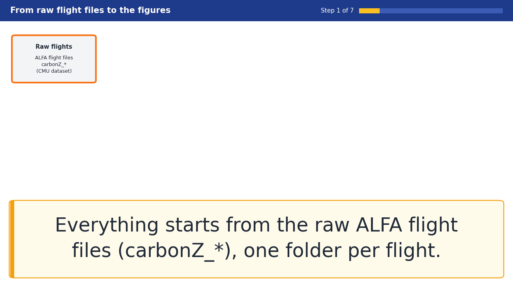 | 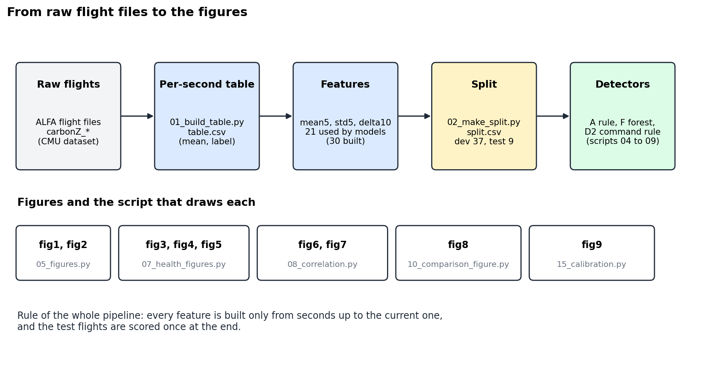 |

ALFA is a set of fixed-wing flights from Carnegie Mellon University in which faults were injected on purpose. Each flight has a logged fault start time, so every second can be labeled as before or after the fault began.

Script 01_build_table.py turns the raw logs into one table with one row per second per flight. It puts the IMU time onto a 1 second grid, averages the readings inside each second, and fills short gaps (up to 5 seconds) forward. For each of 10 signals it then computes three features: the mean of the last 5 seconds, the standard deviation of the last 5 seconds, and the change over the last 10 seconds. All three use only past data, so a feature at second t never sees the future. That gives 30 columns, and the models use the 21 that come from sensors.

Example with made-up numbers: if vertical velocity over the last 5 seconds reads -1.0, -0.8, -0.9, -1.1 and -0.9, then vel_lin_z__mean5 is -0.94. Detector A fires when this value is -0.833 or lower, so this second would be a raw alarm.

The label for second t is 1 when the fault starts before the end of second t (the code tests t + 1 > fault start, in seconds). The first labelled second is therefore the one that contains the fault start, and its readings can fall both before and after the fault. The fault start is the time of the earliest failure_status message in the flight, measured from the first IMU timestamp. Rows in the first 10 seconds and rows with missing values are dropped.

evalkit.load(cap=30) also drops every row more than 30 seconds after the fault began, because long after a fault the flight is usually crashing or over and the rows are not a fair test of early detection. After that cut the table has 4113 rows.

| Script | What it does |
|---|---|
| 01_build_table.py | Builds the per-second feature table from raw logs |
| 02_make_split.py | Assigns the 30 sessions to folds cv0 to cv4 and test, and checks that no session sits in two groups |
| 03_command_features.py | Builds the command-channel features for detector D2: channels 1, 3, 4 and 5 count as frozen when the value does not change for 3 seconds in a row |

### Evaluation design

| Step by step | Static picture |
|---|---|
| 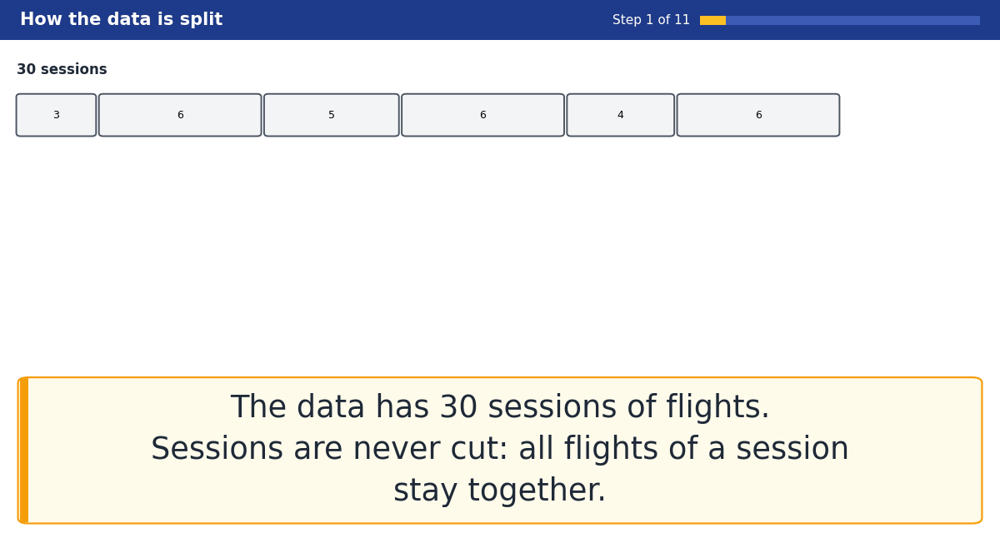 | 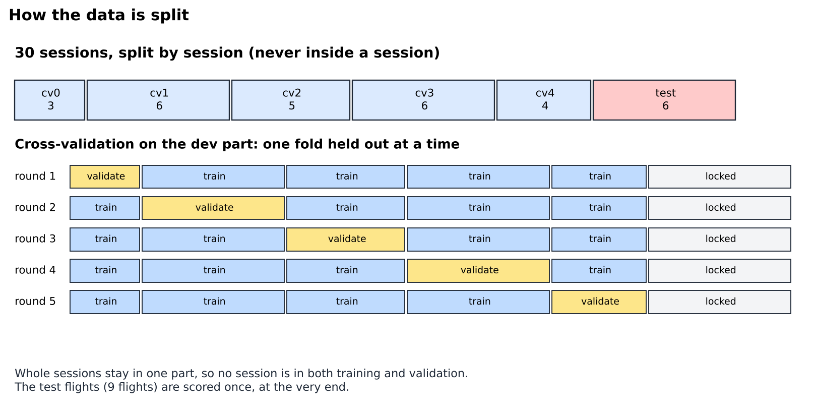 |

The split is by session, not by row or by flight. Seconds from one flight look very alike, and flights from one session share conditions, so splitting at a finer level would let the model see near copies of its test data. The 30 sessions are assigned by hand in the ASSIGN dictionary in 02_make_split.py, and the script stops if any session lands in two groups.

Example: the 5-second mean at second 40 of a flight uses seconds 36 to 40, and the one at second 41 uses seconds 37 to 41. Four of the five seconds are shared. If one of these rows were in training and the other in testing, the model would be tested on a near copy of what it had already seen.

| Group | Rows | Flights | Use |
|---|---|---|---|
| Development (cv0 to cv4) | 3279 | 37 | Fitting, comparing models, choosing thresholds |
| Test (6 sessions) | 834 | 9 | Scored once at the end |

The test set was locked. Every choice, including features, model type and threshold, was made on the development folds. The test numbers in this report were produced by 04_final_test.py a single time.

A raw alarm is a second where the score passes the threshold (0.5 unless stated). The final alarm needs 3 raw alarms in a row, which cuts isolated false alarms at the cost of about 2 seconds of delay. Results are reported as F1, average precision, and false alarms per minute of normal flying.

Example with made-up numbers: raw alarms at seconds 50, 52, 53 and 54. Second 50 stands alone and is ignored. Seconds 52, 53 and 54 are three in a row, so the final alarm starts at second 54. The 3 counts consecutive seconds, not messages and not features.

### What we built and what we found

#### Three detectors

| Detector | What it is | Test F1 |
|---|---|---|
| A | One rule: vel_lin_z__mean5 <= -0.833, found by a one-split stump | 0.46 |
| F | Random forest, 300 trees, min_samples_leaf 5, balanced_subsample, seed 0, threshold 0.5, 3 alarms in a row | 0.50 |
| D2 | Frozen command channel or a throttle rule | 0.87 |

D2 scores high because it reads the command channels, which is where the injected fault shows up. It marks how well a detector can do when it sees the cause, not what a sensor-side detector can reach. Detector A is the honest baseline to beat, since a random guess scores only about 0.006 F1.

#### Comparing models

On the development folds with 5 seeds and a fixed threshold of 0.5, the forest scored F1 0.51, CatBoost 0.54 and a small neural network (MLP) 0.53. False alarms per minute were 0.40, 1.02 and 3.39. The fold-to-fold spread (0.35 to 0.78) is larger than the gaps between models, so the data do not support naming a winner. All three catch only 12 to 27 percent of the other fault types.

#### Choosing the alarm threshold

Instead of fixing 0.5, the threshold can be set so that about a chosen share of normal seconds raise an alarm. We used a conformal-style rule: take the (1 minus alpha) quantile, with the usual correction, of normal-second scores from the other folds. At alpha 0.05 the false-alarm rate came out at 0.052 to 0.054 on average, so the promise holds on average. It does not hold per fold: cv4 reached 0.10 to 0.13. At equal alpha the models are close (F1 at alpha 0.05: forest 0.532, CatBoost 0.532, MLP 0.517). At alpha 0.01 CatBoost led with 0.452 against 0.400 for the forest and 0.329 for the MLP. The forest's fixed 0.5 behaves like alpha 0.02.

#### Four self-checks on the forest

- Calibration: Brier score 0.085 for the forest, 0.089 for CatBoost and 0.131 for the MLP, which equals what always predicting the base rate would score.
- Permutation importance: vel_lin_z__mean5 matters most (0.072). Every other feature is at most 0.026, and 7 of 21 are under 0.001. Two altitude features share credit (0.185 together against 0.052 summed separately). We did not test why.
- Learning curve: average precision rose from 0.612 to 0.660 and F1 from 0.487 to 0.508, and the curve is flat after about 15 to 22 flights. Rare fault types (1 elevator and 3 rudder flights) are too few for this curve to say anything about them.
- Seed stability: the F1 standard deviation across seeds is 0.004 to 0.014.

#### Figures

The figures are in the repository's figures folder: fig1 and fig2 show an engine flight and the frozen command channels, fig3 to fig5 show recall by fault type, the confusion matrix and an alarm timeline, fig6 and fig7 show feature and label correlations, and fig8 compares the models.

#### API demo

api.py is a FastAPI service around one forest trained on all 37 development flights. It takes finished feature values per second, not raw logs, and returns a probability, a raw alarm, a final alarm and the first alarm second. The threshold can be overridden between 0 and 1. GET /health lists the 21 expected features, and a request with missing features gets a 422 that names them. The tests run in GitHub Actions (20 pass locally; data tests are skipped on CI because the data is not in the repo).

### Why not correlation, and why not the other methods

Two heatmaps came out of 08_correlation.py. Fig6 shows which features duplicate each other. Fig7 shows how each feature moves with the fault label inside a flight, split by fault type. We used them to look at the data. We did not use them to choose features: all 21 sensor features stayed, and flights the model had not seen decided whether the model was any good.

One honest limit: we never ran a correlation-based feature selection and compared its score. The table below says why we did not trust the method to decide, not that it was tested and lost.

| Method | Why it was not the decider | Example from this project |
|---|---|---|
| Keep the features most correlated with the label | One number per feature, linear only, and the sign changes between fault types | roll_gap__std5 is +0.57 for rudder, +0.29 for aileron and -0.37 for elevator. xtrack_error__std5 is 0.50 for rudder but -0.06 for engine |
| Drop one of each highly correlated pair | Fig6 shows alt_error__std5 and hud_altitude__std5 as near duplicates, but they share credit | Permuted together they score 0.185, summed one at a time 0.052. We did not test whether dropping one changes the score |
| Remove features with tiny importance | 7 of 21 are under 0.001, but the differences are small and measured on the same folds we tuned on | Dropping them would gain little and risks fitting the development noise |
| Random split of rows | Neighbouring seconds are near copies | See the 5-second mean example in Evaluation design |
| Accuracy as the score | Normal seconds are the majority. The share of fault seconds is about 0.157 (chance AP), so always saying normal is right about 84 percent of the time and catches nothing | Random-guess F1 is about 0.006, which is why F1 and false alarms per minute are used |
| A deep network on raw signals (CNN) | Few fault seconds to learn from: 301 engine, 13 elevator, 150 aileron and 44 rudder in fig3. Not tested here, kept as a later project | The small MLP we did test had the most false alarms (3.39 per minute) and Brier 0.131, equal to always guessing the base rate |
| Pick the model with the best single run | Fold scores range from 0.35 to 0.78 | The forest, CatBoost and MLP differ by less than that range |
| Fixed threshold of 0.5 | It is arbitrary and says nothing about the false alarm rate | The conformal rule sets the threshold from a chosen alpha. The forest's 0.5 behaves like alpha 0.02 |
| Use D2 as the model | It reads the injected fault itself | Scores 0.87 but could not be used on sensors alone |

What replaced correlation as the judge is the loop used throughout: fit on four folds, score the fifth, repeat, and repeat again with 5 seeds. A feature earns its place by what it does on flights the model has not seen, not by its colour on a heatmap.

### Mistakes along the way

These are the errors we hit and what each one changed. Most were small, but several would have put a wrong number or a wrong claim in the report.

| What went wrong | What we concluded |
|---|---|
| Splitting rows or flights would have put near copies of a flight in both train and test | Split by session, and make the script fail if a session appears in two groups |
| A figure (fig8) was stale after the model results changed | Regenerate every figure from saved results (results/oof_models.csv) instead of trusting an old image |
| I said the MLP was badly calibrated because of class weights | Wrong: all three models use class weights. The claim was withdrawn and the calibration gap is reported without a cause |
| A patch check counted 4 matching lines when the file had 3 | Check by running the search, not by counting by eye |
| .NET file calls with a relative path looked in the user home folder | Use full absolute paths in PowerShell file edits. The failed attempts wrote nothing |
| The C: drive was nearly full | Keep the project, environments and pip downloads on E:\ml-course and install with --no-cache-dir |
| uvicorn failed on port 8000 (already in use) | Start the demo on another port, for example 8011 |
| The API root URL showed {"detail":"Not Found"} | Expected: there is no route at /. Use /health and /predict |
| Early commits carried extra author trailers and the repo listed unwanted contributors | Recreate the repo history and commit without co-author trailers. AI help is credited only as one line in the README |
| pytest first collected 0 tests, and the wrong Python (anaconda) was used at one point | Set pytest to find src, and run everything from the project's own virtual environment |
| A fixed threshold of 0.5 seemed arbitrary, and a promised false-alarm rate was tested only on average | Report the conformal threshold per fold too. It held on average but not in cv4 |
| Model rankings looked decisive on one run | Use 5 seeds and fold spread. The spread is larger than the gap between models, so no winner is declared |
| Claude described both flights of an overlapping session pair as elevator faults without reading the folder names. The cv3 flight was a no-failure flight. AI fixes can chain into new errors when each step builds on an unchecked claim. The same day, a blanket undo of path changes also broke lines in 05_figures.py that had not been changed, and it was caught only by reading the diff | Check every claim against the code or the data before the next change, change only what is actually wrong, and read the full diff before applying it |

### Libraries and versions

Exact versions are pinned in the requirements files in the repository, so this table names the libraries and what each is for rather than repeating version numbers that could drift out of date. Run pip freeze in your own environment for the current list.

| Environment and file | Libraries | Used for |
|---|---|---|
| Main (requirements.txt) | pandas, numpy | Building the feature table and handling data |
| Main | scikit-learn | Random forest, the one-split stump, metrics |
| Main | CatBoost | Gradient boosting model in the comparison |
| Main | matplotlib | All figures |
| Main | pytest | The test suite |
| Neural network (requirements-tf.txt) | TensorFlow | The small MLP in the model comparison. Kept separate because it is large |
| API (requirements-api.txt) | FastAPI, uvicorn | The demo service and its server |
| API | joblib | Saving and loading the trained forest (models/forest.joblib) |

On CI, GitHub Actions installs the packages and runs the tests. The tests that need the dataset are skipped there.

### Outside tools and how to add one

No code from another repository is used in this project yet. Everything above comes from the libraries in the table. If you want to add a tool from another repo later, work through this list first.

| Check | Why |
|---|---|
| Read the license | An unlicensed or restrictive repo cannot be copied into a public project |
| Read the code you will run | You must be able to explain it, which is the rule for this project |
| Prefer a pip package over copied files | A package has a version you can pin in requirements.txt |
| Pin the version and note it in the README Credits | Results stay reproducible |
| Try it on a copy of the data and the development folds only | The test set stays locked |
| Run the tests before and after | A new tool must not change existing results without you noticing |

Two rules apply to every addition. No company data of any kind goes into the project, its documents or its slides. And no API keys go into the repository or into chat; keep them in environment variables.

### Limits and open questions

- The test set is 9 flights. One more or one fewer caught fault moves the F1 noticeably, so 0.46 versus 0.50 is not a real difference.
- Fold results range from 0.35 to 0.78 F1, so any single number hides a lot of variation.
- Other fault types (anything but the engine faults) are caught only 12 to 27 percent of the time, and the dataset has 1 elevator and 3 rudder flights.
- D2 reads the command channels. It shows a ceiling and is not a deployable sensor-side detector.
- The conformal threshold keeps its promise on average but not in every fold.
- Why the two altitude features share credit in permutation importance is untested.
- The API takes finished feature values. A real deployment would need the feature building from raw logs in the same service.
- The 10 signals were chosen in the early experiments (step6_effect.py, step7_effect2.py, step8_placebo.py), which looped over every flight folder before the split existed. So the 9 test flights were visible when the signals were picked. The models and thresholds were still fitted on dev flights only, but the feature choice was not blind to the test set. A redo on 2026-11-14 (experiments/screening_dev_only.py) built the same screening table from the 28 dev fault flights only. The 7 chosen sensor signals rank 1, 2, 3, 5, 6, 8 and 15 out of 26 there, against 1, 2, 3, 7, 8, 11 and 16 with all flights, so the dev flights alone point to the same signals. roll_gap ranks low in both. The original choice was made by reading the tables, so this redo uses one fixed score (after-fault change minus the change at a placebo time 30 s earlier) and cannot replay that judgment exactly.
- The test rows are read again after 04_final_test.py: 05_figures.py refits on dev and predicts on test to draw fig1, step23_rudder_check.py looks at test fault rows, and export_fig_data.py exports test rows for the GIFs. Nothing was tuned from these looks, but "scored once" means the reported numbers come from 04 only.
- Some sessions overlap in time (src/20_session_overlap.py finds 6). The only one that touches the test set is 2018-09-11-14-41-51 (test, elevator) and 2018-09-11-14-41-38 (cv3, no failure). They share no timestamps and overlap by about 6 seconds at the edge, so no rows are copied, but they come from the same time in the air. The 2018-10-05 pair and the 2018-10-18 group overlap by up to about 2 minutes across dev folds. A check on 2026-11-13 found no shared timestamps in any overlapping pair, and no pair whose 1 second altitude traces match at any time shift (the closest mean difference is about 1.2 m, as close as flights from different days). So no flight is a copy of another. Why four engine-failure flights on 2018-10-18 have overlapping timestamps is not explained; it looks like a clock offset in the recordings.

### Unsolved problems

Questions that the checks so far raised but did not answer.

1. Non-engine faults from sensors alone. Aileron, rudder and elevator faults are caught 12 to 27 percent of the time. It is open whether other signals, longer windows or a detector trained on normal flights only would do better, and there are only 1 elevator and 3 rudder flights to test that on.
2. A fair command-side detector. The recorded rc-out commands already contain the injected fault, so ALFA cannot show how a command-side detector would do on a real failure.
3. Signal choice. roll_gap is used although the screening ranks it 15th or 16th of 26, and yaw_measured and hud_climb rank 4th and 7th on dev flights but are not used. Whether swapping them changes the results is untested.
4. The first seconds of each flight. Dropping the first 30 s makes several delta10 and xtrack_error correlations stronger (experiments/drift_check.py). Whether the detectors gain from dropping those seconds is untested.
5. Overlapping clocks on 2018-10-18. Four engine-failure flights have overlapping timestamps, which one plane cannot fly. No data is copied, and a clock offset is the likely cause, but it is not confirmed.

### Credits

Project owner: Pham Anh Hoang (GitHub: PhamAnhHoangg). Data: the ALFA dataset from Carnegie Mellon University, downloaded from its original source.

AI assistance tool: Claude Sonnet 5.5 (Anthropic)

---

## Part 2. ALFA fault detection: setup and handoff lesson

This lesson gets the project running on a new Windows PC, step by step. Everything here is PowerShell. Work in this order and stop at the first error.

### 1. What you need first

- Windows with PowerShell, Git, and Python 3.10 or newer from python.org (not the anaconda one).
- About 3 GB free on a drive that is not full. In the original setup C: was full, so everything lives on E:\ml-course.
- The ALFA dataset, downloaded from its original source (Carnegie Mellon University). The data is not in the repository.

### 2. Get the code

```powershell
cd X:\your-folder
git clone https://github.com/PhamAnhHoangg/alfa-fault-detection
cd alfa-fault-detection
```

### 3. Create the main environment

```powershell
python -m venv .venv
.\.venv\Scripts\Activate.ps1
pip install --no-cache-dir -r requirements.txt
```

The flag --no-cache-dir stops pip from filling the C: drive with a download cache. Check that python now points inside .venv with `Get-Command python`.

### 4. Optional environments

| Need | Command | Notes |
|---|---|---|
| Neural network comparison (script 09) | `python -m venv .venv-tf`, activate it, then `pip install --no-cache-dir -r requirements-tf.txt` | TensorFlow is large, so it has its own environment |
| API demo | `pip install --no-cache-dir -r requirements-api.txt` in the main environment | Adds FastAPI, uvicorn and joblib |

### 5. Point the code at the data

Choose one data folder. The raw flights must sit inside it at `alfa\processed\processed\carbonZ_<flight>` (this is the path in `01_build_table.py`), and the scripts write `table.csv`, `split.csv` and `table2.csv` into the same folder. Then tell the scripts where it is:

```powershell
$env:ALFA_DATA = "X:\your-folder\data"
```

If ALFA_DATA is not set, the code uses a folder named `data` inside the project (`config.py`, line 5). This setting lasts for the current window only. Set it again in each new PowerShell window. The data folder is in .gitignore and must never be committed.

### 6. Run order

| Step | Script | Result |
|---|---|---|
| 1 | src\01_build_table.py | Per-second feature table |
| 2 | src\02_make_split.py | split.csv with sessions assigned to folds |
| 3 | src\03_command_features.py | table2.csv with command-channel features |
| 4 | src\04_final_test.py | The locked test result. Run it once, at the end |
| 5 | src\05_figures.py | fig1 and fig2 |
| 6 | src\06_oof_predictions.py and 07_health_figures.py | Out-of-fold predictions and fig3 to fig5 |
| 7 | src\08_correlation.py, 09_model_comparison.py, 10_comparison_figure.py | fig6 to fig8 and the model comparison |
| 8 | src\12 to 17 | Conformal thresholds, baseline, calibration, permutation importance, learning curve |
| 9 | src\18_train_final.py | Saves models\forest.joblib |

Run each script with `python src\NAME.py` from the project folder.

### 7. Run the API and the tests

```powershell
python -m uvicorn api:app --app-dir src --port 8011
```

Open http://127.0.0.1:8011/health in a browser. The root address shows Not Found, which is normal. If the port is busy, pick another number. Then run `python src\19_sample_request.py` for a sample request, and `pytest` for the tests. Twenty tests pass locally. Tests that need the data are skipped when the data is missing.

### 8. Common problems

| Problem | Fix |
|---|---|
| File edit with .NET looks in the user's home folder | Use full absolute paths |
| pytest collects 0 tests | Run it from the project folder inside .venv |
| Wrong python version appears | Activate .venv first and check with Get-Command python |
| Port already in use | Use a different --port |
| LF and CRLF warnings from git | Harmless, ignore them |
| Disk full | Keep everything on E: and use --no-cache-dir |
| The table is not found after opening a new window | Set $env:ALFA_DATA again. The folder that holds table.csv is the value to use |

### 9. Rules to keep

- No company data in this project, its documents or its slides.
- The test set stays locked. Score it once.
- No API keys in chat or in the repository.
- Commit without co-author trailers. The README credits AI help in one line at the end.
- Be able to explain every line you add.

---

## Part 3. ALFA fault detection: every number and formula

This page traces each number in the project back to a formula and to the raw file it starts from. All formulas were checked against the scripts in src, so a reader can follow a number without reading the code.

### Notation

Every row of the project's table is one second of one flight. A flight has raw readings with timestamps in nanoseconds. T0 is the timestamp of the first IMU reading of that flight, and every second is counted from it.

| Symbol | Meaning | Name in the code |
|---|---|---|
| t | Second index: a reading at time tau (ns) belongs to second t = floor((tau - T0) / 1,000,000,000) | t |
| x_t | The value of one signal in second t (the mean of that second's readings) | the per-second series |
| phi | Fault start in seconds: (earliest failure_status time - T0) / 1e9. Usually not a whole number | fault_sec |
| y_t | Label of second t: 1 if t + 1 > phi, otherwise 0 | label |
| t - phi | Time relative to the fault, negative before it | t_rel_fault |
| p_t | The model's fault probability for second t | proba |
| a_t | Raw alarm: 1 if p_t is at least the threshold (0.5 unless stated) | pred_raw |
| A_t | Final alarm: 1 if a_t, a_(t-1) and a_(t-2) are all 1 inside the same flight | pred |

The label means the fault starts before the end of second t. If phi = 116.3, second 116 is the first with label 1, and its t - phi is -0.3.

### From a raw flight to one table row

| Step by step | Static picture |
|---|---|
| 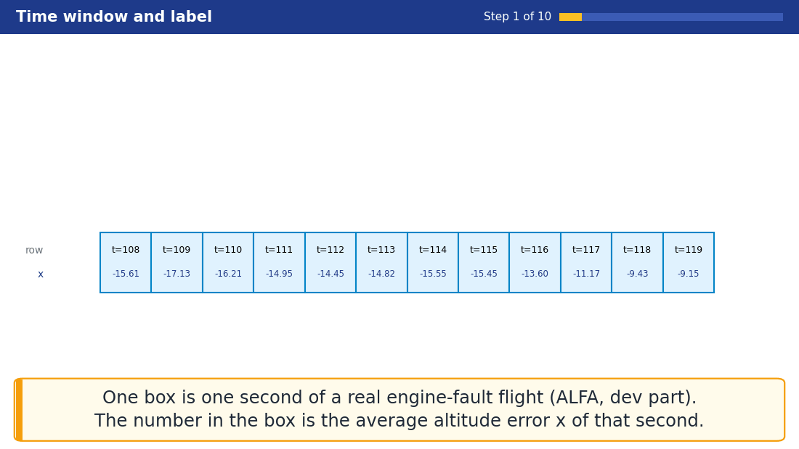 | 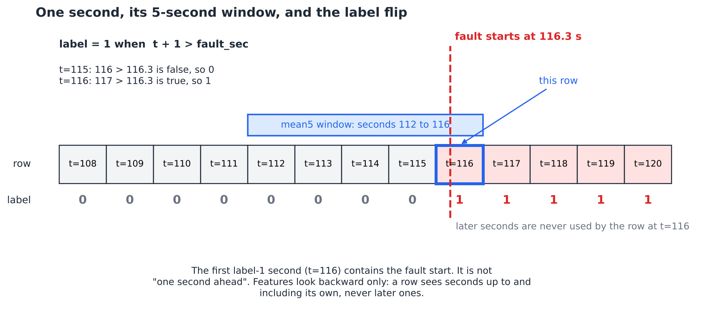 |

The numbers of a real flight, step by step: [GIF 5](../figures/gif5_numbers.gif).

Script 01_build_table.py reads each flight folder under data\alfa\processed\processed. Every file is named like carbonZ_<timestamp>*<n>*<fault words>-<topic>.csv.

#### The ten signals and where each comes from

| Signal name | File (topic) | Column | Transform |
|---|---|---|---|
| alt_error | mavros-nav_info-errors | field.alt_error | none |
| xtrack_error | mavros-nav_info-errors | field.xtrack_error | none |
| hud_altitude | mavros-vfr_hud | field.altitude | none |
| vel_lin_z | mavros-local_position-velocity | field.twist.linear.z | none |
| roll_gap | mavros-nav_info-roll | field.measured, field.commanded | wrap(measured - commanded) |
| pitch_gap | mavros-nav_info-pitch | field.measured, field.commanded | wrap(measured - commanded) |
| yaw_gap | mavros-nav_info-yaw | field.measured, field.commanded | wrap(measured - commanded) |
| rc_out_1 | mavros-rc-out | field.channels1 | none. Left out of the models by its name |
| cause_rc_out_2 | mavros-rc-out | field.channels2 | none. Used only by detector D2 |
| cause_hud_throttle | mavros-vfr_hud | field.throttle | none. Left out of the models by its prefix cause_ |

wrap(a) = ((a + 180) mod 360) - 180, which keeps an angle difference between -180 and 180 degrees.

#### The formulas, in order

1. Per-second value: x_t = the mean of all readings of that signal that fall in second t. A second with no readings is empty and is filled forward for at most 5 seconds.
2. mean5 at t = the mean of x over seconds t-4 to t, defined when at least 3 of those values exist.
3. std5 at t = the sample standard deviation of the same window, sqrt( sum of (x_u - mean)^2 / (m - 1) ), where m is the number of values used (at least 3).
4. delta10 at t = x_t - x_(t-10), empty if either value is missing.
5. Fault start phi = (the earliest first timestamp among the failure_status files - T0) / 1e9. A flight with no failure_status file gets label 0 everywhere.
6. Label: y_t = 1 if t + 1 > phi. Time relative to the fault: t - phi.
7. Fault type from the flight name: no_failure gives none. Otherwise the first of engine, rudder, elevator, aileron found in the name, in that order. A name that contains both rudder and aileron is therefore typed rudder.
8. Rows with t below 10 and rows with any missing feature are dropped. Flights marked no_ground_truth are skipped.

Example with made-up numbers: if x over seconds 6 to 10 is -0.2, 0.0, -0.1, 0.1, -0.2, then mean5 at second 10 is -0.4 / 5 = -0.08. The deviations from -0.08 square and sum to 0.068, so std5 = sqrt(0.068 / 4) = 0.13.

#### Command features for detector D2 (03_command_features.py)

For each rc-out channel i in 1, 3, 4, 5 and each second t: sd = the standard deviation of that second's readings with divisor n (not n - 1), and c = how many readings there are. z_t = 1 if sd = 0 and 0 otherwise, and it is empty if c is below 2. Then frozen_t = the minimum of z over seconds t-2, t-1, t, which is 1 only when all three seconds exist and are frozen, and 0 otherwise. cmd_frozen_any = the largest of the four channels. This is where the 3 in a row for frozen channels comes from.

### Which rows are used

| Step | Rule | Where |
|---|---|---|
| Table | One row per second per flight, t at least 10, no missing features | 01_build_table.py |
| Merge | Each flight gets its role (cv0 to cv4 or test) from split.csv | evalkit.load |
| Cap | Rows with t - phi above 30 are dropped. Flights without a fault have no t - phi, so they are kept in full | evalkit.load(cap=30) |
| Result | 4113 rows: 3279 development rows from 37 flights and 834 test rows from 9 flights |  |
| Split | 30 sessions were assigned by hand to cv0 to cv4 and test. A session is never split | 02_make_split.py |
| Out-of-fold | For fold k, train on the other four folds and predict fold k | 06, 09, 12 to 17 |

#### The 21 features

All columns whose name contains two underscores are features: 10 signals times 3 statistics = 30. Names starting with cause_ are removed (6), and names starting with rc_out are removed (3). That leaves 21: alt_error, xtrack_error, hud_altitude, vel_lin_z, roll_gap, pitch_gap and yaw_gap, each with mean5, std5 and delta10.

### Metric formulas

All counts are over seconds (rows) of the group being scored, usually one held-out fold.

| Name | Formula | In evalkit.evaluate |
|---|---|---|
| 3 in a row | A_t = min(a_t, a_(t-1), a_(t-2)) inside one flight. The first two rows of a flight are 0 | persist(d, pred, 3) |
| TP, FP, FN | Counts of rows where the final alarm and the label are (1,1), (1,0) and (0,1) | tp, fp, fn |
| Precision | TP / (TP + FP) | prec |
| Recall | TP / (TP + FN) |  |
| F1 | 2 * precision * recall / (precision + recall) | f1 |
| False alarms per minute | FP / (N0 / 60), where N0 is the number of rows with label 0 | fa_s_per_min |
| Engine recall | The share of rows with label 1 in engine flights that have A_t = 1 | rec_eng |
| Other recall | The same for fault flights that are not engine | rec_oth |
| Delay | For each fault flight with at least one alarm on a label 1 row: max(smallest t - phi among those rows, 0). The median over flights | med_delay_s |
| Average precision | AP = sum over thresholds of (R_n - R_(n-1)) * P_n, computed on the raw scores p_t | ap |
| Chance level of AP | The share of rows with label 1 |  |
| Brier score | the mean of (p_t - y_t)^2. Always predicting the share pi gives pi * (1 - pi) |  |

F1 is computed on each fold alone and then averaged, so a number such as 0.51 is the mean of five fold scores.

Example with made-up numbers: a fold has 600 normal seconds and 40 fault seconds. The model raises 6 alarms on normal seconds and 20 on fault seconds. Precision = 20 / 26 = 0.77, recall = 20 / 40 = 0.50, F1 = 2 * 0.77 * 0.50 / 1.27 = 0.61, and false alarms per minute = 6 / (600 / 60) = 0.6.

### Detectors and models

| Name | Definition |
|---|---|
| Detector A | fit_rule tries every feature of the 21, every threshold in the unique values of the 2%, 4%, ... 98% quantiles of that feature (49 candidates), and both directions (at least, at most). It keeps the one with the highest F1 on the development rows, before the 3-in-a-row rule. The result is vel_lin_z__mean5 <= -0.833. The alarm is then that rule with 3 in a row |
| Detector F | A random forest with 300 trees, min_samples_leaf 5, class_weight balanced_subsample, random_state 0. In scripts 04 and 05 it sits behind a median imputer. Alarm: p_t at least 0.5, then 3 in a row |
| Detector D2 | The command-side detector: cmd_frozen_any equals 1, or the 3-in-a-row alarm of a one-feature rule fitted by fit_rule on cause_rc_out_2__mean5 |
| CatBoost | 300 iterations, depth 4, learning rate 0.05, auto_class_weights Balanced |
| MLP | Inputs scaled with a StandardScaler fitted on the training rows. Layers: 32 relu, dropout 0.2, 16 relu, 1 sigmoid. Adam, learning rate 0.001, binary cross-entropy, 60 epochs, batch 64 |

Balanced class weights mean each class c gets the weight n / (2 * n_c), where n is the number of training rows and n_c the rows of that class. Model comparison runs seeds 0 to 4, so each model and fold is trained 5 times.

### Figure by figure

Each figure below has the picture first, then the formula for the numbers on it, then the code that produces those numbers. The code is copied from the project scripts. Names such as t_rel_fault and label are explained in the Notation section.

#### Fig1: one engine flight and three detectors

| Step by step | Final figure |
|---|---|
| 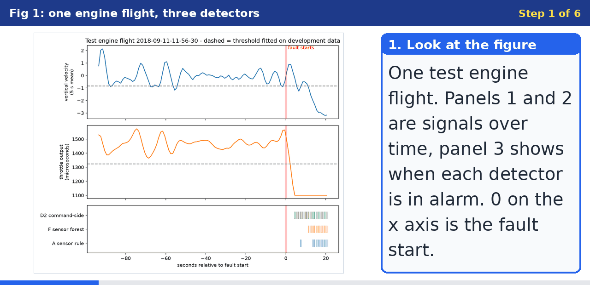 | 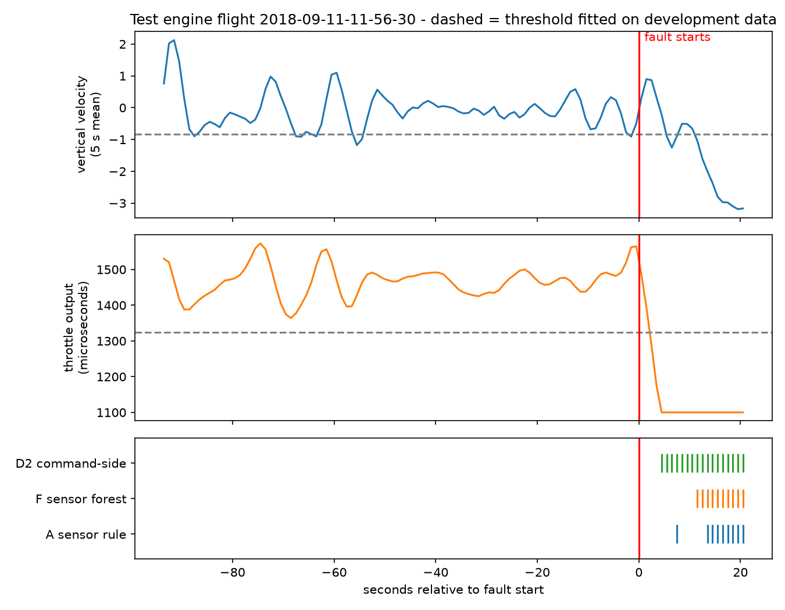 |

**Formula**

- Top panel: vel_lin_z__mean5 at second t is the mean of the per-second vertical velocity over seconds t-4 to t. At least 3 of the 5 values must exist.
- Dashed line: the threshold fitted on the development rows, vel_lin_z__mean5 <= -0.833.
- Raw alarm a_t is 1 when the mean5 value is at or below the threshold. Final alarm A_t = min(a_t, a_(t-1), a_(t-2)) inside the flight.
- Middle panel: cause_rc_out_2__mean5, the same 5-second mean of throttle output channel 2, in microseconds, with its own fitted threshold.
- Bottom panel: a tick at x = t - phi (t_rel_fault) for every second with a final alarm from detector A, F or D2. The red line is x = 0.

**Code that produces the numbers** (05_figures.py and evalkit.py)

```python
ruleA = fit_rule(dev, sensors)                      # best single rule on development rows
predA = persist(test, apply_rule(test, ruleA), 3)   # 3 seconds in a row
ruleT = fit_rule(dev, ["cause_rc_out_2__mean5"])
thr = persist(test, apply_rule(test, ruleT), 3)
predD = (test["cmd_frozen_any"].to_numpy() == 1) | thr

eng = test[test["fault_type"] == "engine"]
fl = eng.groupby("flight")["label"].sum().idxmax()  # engine test flight with most fault rows
g = test[test["flight"] == fl]
x = g["t_rel_fault"]
ax[0].plot(x, g["vel_lin_z__mean5"])
ax[0].axhline(ruleA[3], ls="--")                    # ruleA[3] is the threshold, -0.833

# evalkit.py
def persist(d, pred, k):
    s = pd.Series(np.asarray(pred, dtype=int), index=d.index)
    r = s.groupby(d["flight"]).transform(lambda x: x.rolling(k, min_periods=k).min())
    return r.fillna(0).astype(bool).to_numpy()
```

#### Fig2: raw command channels around the fault

| Step by step | Final figure |
|---|---|
| 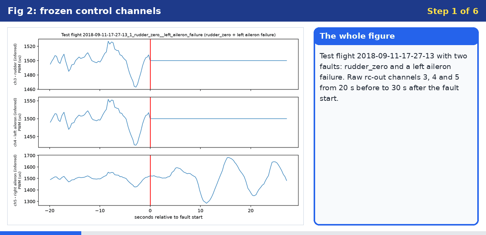 | 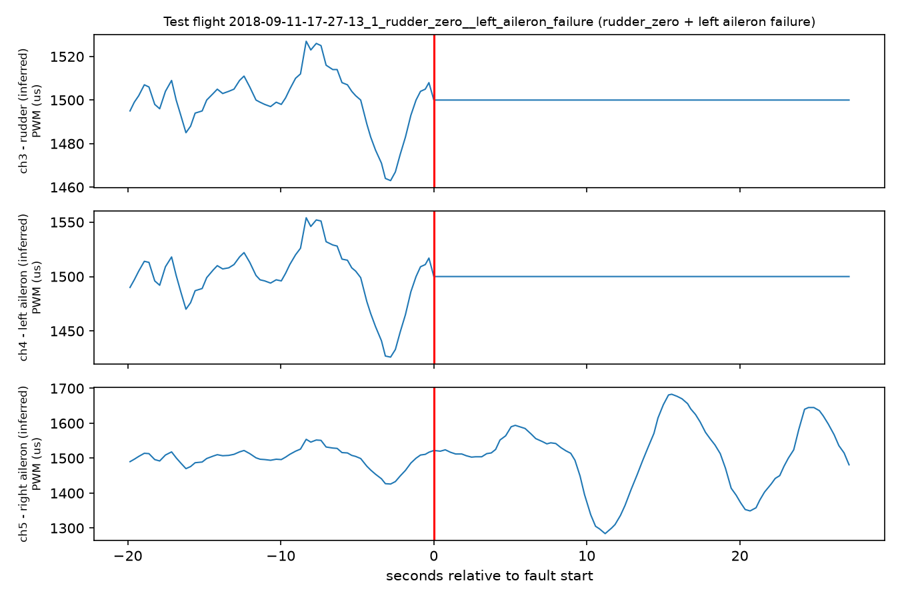 |

**Formula**

- Fault time in nanoseconds: fault_ns = the smallest first timestamp among the failure_status files of the flight.
- Horizontal axis: rel = (reading time in ns - fault_ns) / 1,000,000,000, kept from -20 s to 30 s.
- Vertical axis: the raw value of field.channels3, 4 and 5 of the mavros-rc-out file, in microseconds (PWM). Nothing is averaged or transformed.
- The title and the channel names are typed into the script, so they are not read from the data.

**Code that produces the numbers** (05_figures.py)

```python
fl2 = test[test["fault_type"] == "rudder"]["flight"].iloc[0]
folder = ROOT / ("carbonZ_" + fl2)
fs = list(folder.glob("*failure_status*.csv"))
fault_ns = min(pd.read_csv(f, usecols=["%time"])["%time"].min() for f in fs)
d = pd.read_csv(folder / f"{folder.name}-mavros-rc-out.csv")
d["rel"] = (d["%time"] - fault_ns) / 1e9
d = d[(d["rel"] >= -20) & (d["rel"] <= 30)]
ax.plot(d["rel"], d[f"field.channels{ch}"])        # ch = 3, 4, 5
```

#### Fig3: recall by fault type

| Step by step | Final figure |
|---|---|
| 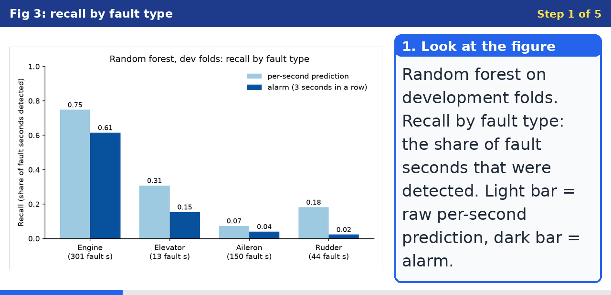 | 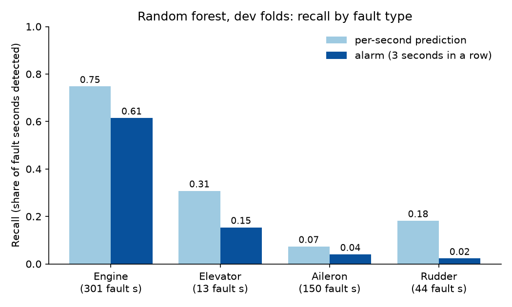 |

**Formula**

- For fault type k, take only the rows with label 1 and fault type k. Recall = the share of those rows where the prediction is 1.
- Light bar: the raw per-second prediction a_t. Dark bar: the final alarm A_t (3 in a row).
- Numbers on the bars: engine 0.75 and 0.61 on 301 fault seconds, elevator 0.31 and 0.15 on 13, aileron 0.07 and 0.04 on 150, rudder 0.18 and 0.02 on 44.
- The predictions are out-of-fold: each fold is predicted by a forest trained on the other four folds (script 06).

**Code that produces the numbers** (07_health_figures.py)

```python
df = pd.read_csv(config.PROJECT / "results" / "oof_predictions.csv")
y = df["label"] == 1
for t in types:
    m = y & (df["fault_type"] == t)
    raw.append(df.loc[m, "pred_raw"].mean())   # light bar
    alarm.append(df.loc[m, "pred"].mean())     # dark bar
    n.append(int(m.sum()))                     # fault seconds under the name
```

#### Fig4: confusion matrix

| Step by step | Final figure |
|---|---|
| 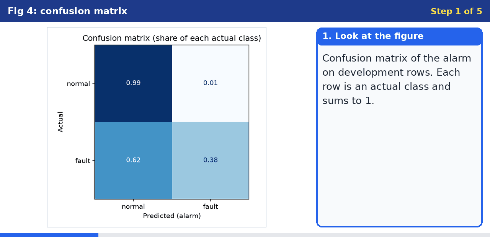 | 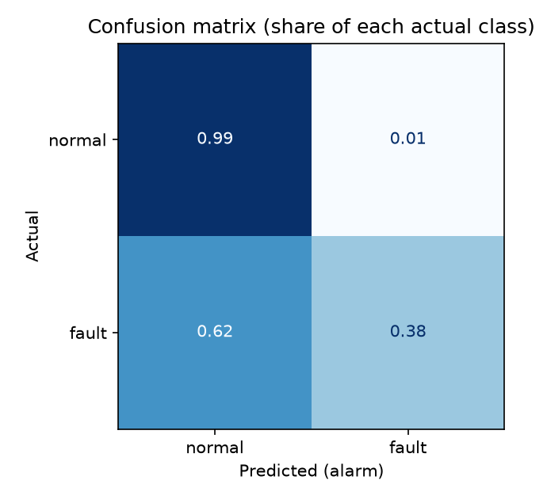 |

**Formula**

- Each cell = the count of rows with that actual class and that predicted class, divided by the number of rows of the actual class (normalize true). Each row of the matrix adds to 1.
- Normal row: 0.99 predicted normal, 0.01 predicted fault. Fault row: 0.62 predicted normal (missed), 0.38 predicted fault (caught).
- The 0.99 is the share of normal seconds left alone. It is not the accuracy of the model.

**Code that produces the numbers** (07_health_figures.py)

```python
ConfusionMatrixDisplay.from_predictions(
    y, df["pred"], display_labels=["normal", "fault"],
    normalize="true", values_format=".2f", cmap="Blues", ax=ax, colorbar=False)
```

#### Fig5: alarm timeline per fault flight

| Step by step | Final figure |
|---|---|
| 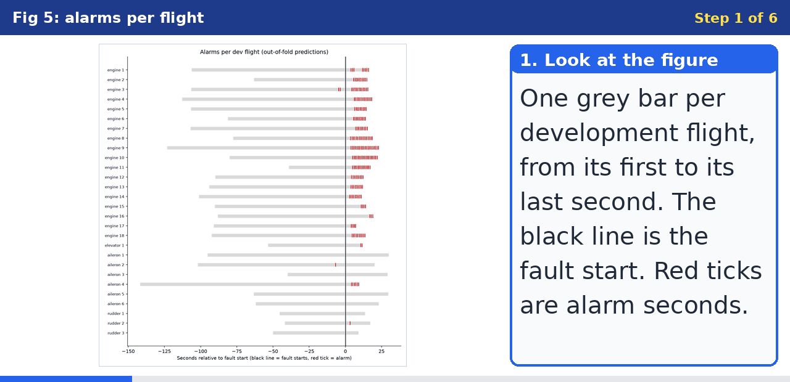 | 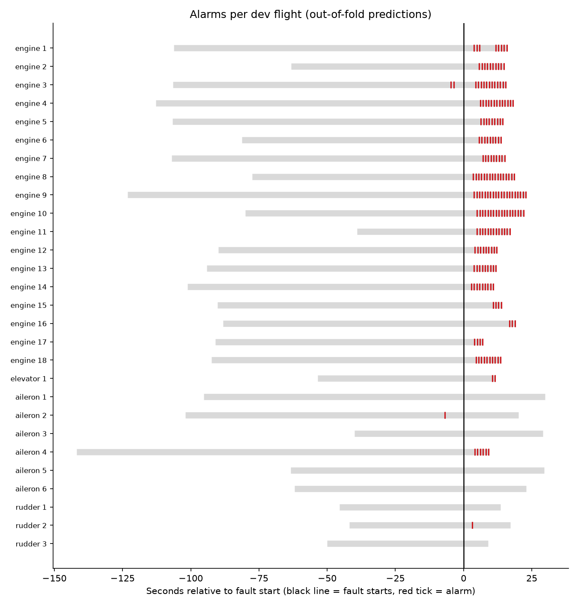 |

**Formula**

- One grey bar per fault flight, from its first to its last second, plotted against t - phi.
- A red tick at t - phi for every second where the final alarm A_t is 1.
- The black line is t - phi = 0. A tick at t - phi of -1 or lower is a false alarm. A tick between -1 and 0 is in the first second labelled 1.

**Code that produces the numbers** (07_health_figures.py)

```python
f = df[(df["fault_type"] != "none") & df["t_rel_fault"].notna()].copy()
for i, row in order.iterrows():
    g = f[f["flight"] == row["flight"]]
    ax.hlines(i, g["t_rel_fault"].min(), g["t_rel_fault"].max(), color="#d9d9d9", lw=7)
    a = g[g["pred"]]                                  # seconds with a final alarm
    ax.scatter(a["t_rel_fault"], [i] * len(a), marker="|", color="#cb181d")
ax.axvline(0, color="black")
```

#### Fig6: which features duplicate each other

| Step by step | Final figure |
|---|---|
| 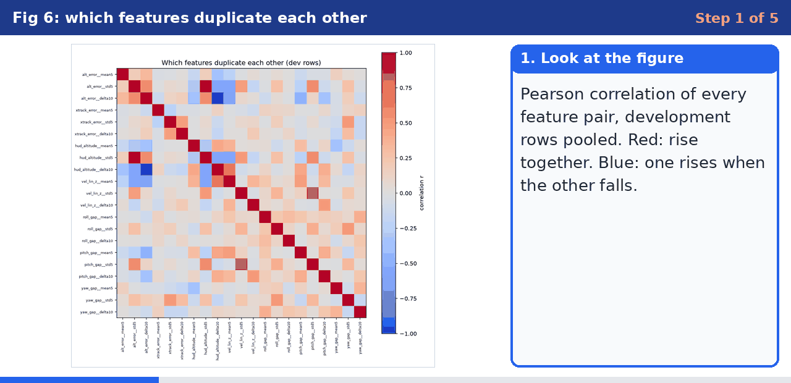 | 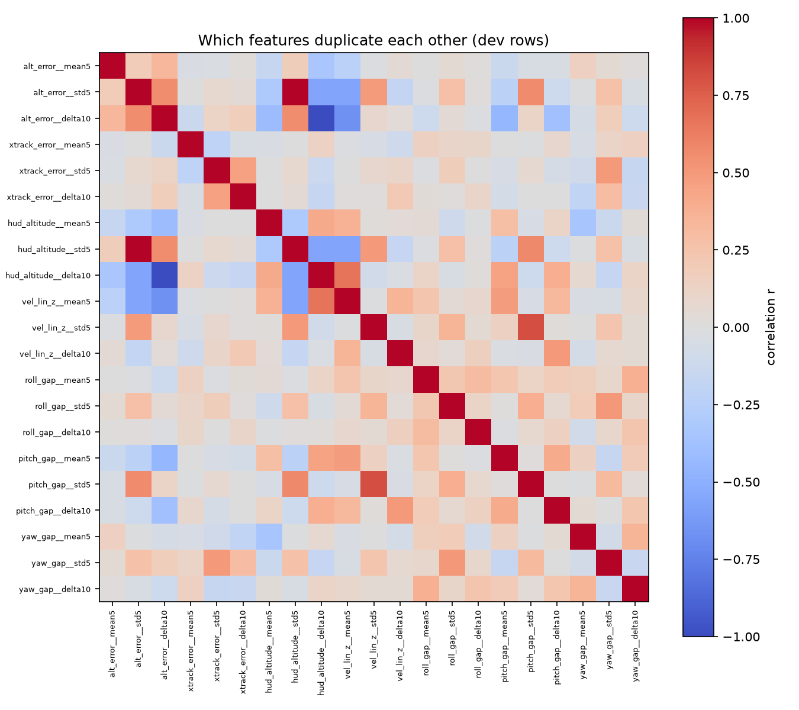 |

**Formula**

Cell (i, j) is the ordinary Pearson correlation of feature i and feature j over all development rows pooled:

r = sum((x - mean x) * (z - mean z)) / sqrt( sum((x - mean x)^2) * sum((z - mean z)^2) )

The colour scale runs from -1 to 1. The script also prints every pair with |r| above 0.9.

**Code that produces the numbers** (08_correlation.py)

```python
cols = [c for c in sym if not c.startswith("rc_out")]   # the 21 features
cm = dev[cols].corr()                                   # Pearson, all dev rows pooled
im = ax.imshow(cm.to_numpy(), cmap="coolwarm", vmin=-1, vmax=1)
```

#### Fig7: which features move with the fault

| Step by step | Final figure |
|---|---|
| 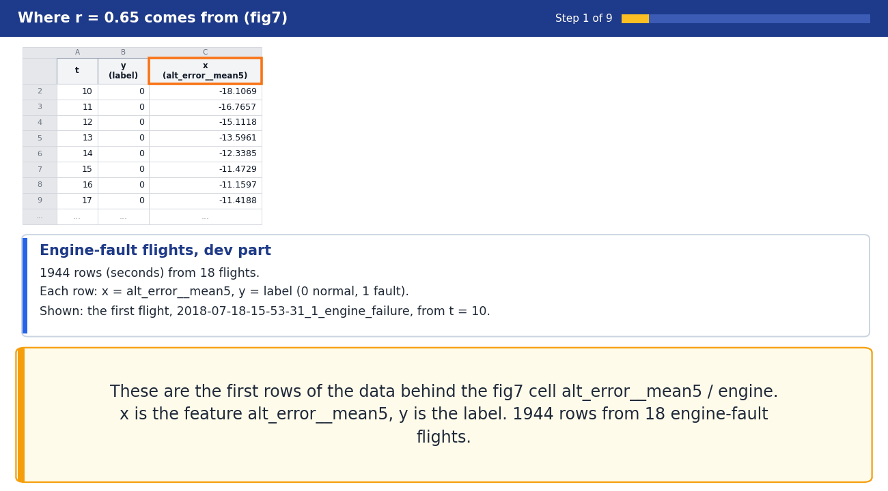 | 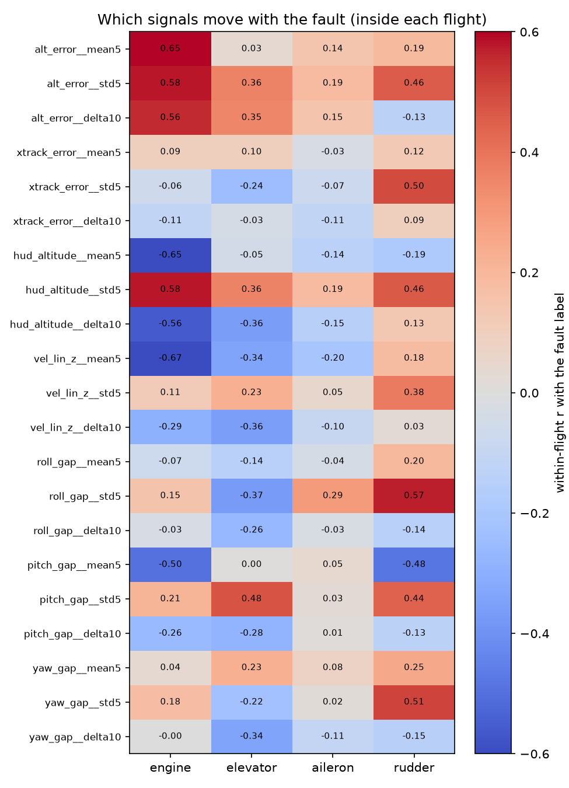 |

**Formula**

One cell is one feature and one fault type. Take the development rows of flights with that fault type. In each flight, subtract the flight's own average from the feature and from the label:

x_tilde = x - (average of x in that flight)

y_tilde = y - (average of y in that flight)

Then one correlation over all those rows together:

r = Sxy / sqrt(Sxx * Syy), where Sxy = sum of x_tilde * y_tilde, Sxx = sum of x_tilde squared, Syy = sum of y_tilde squared.

Sxx comes from squaring x_tilde, the feature after the flight average is removed. Syy comes from squaring y_tilde, the label after the flight average is removed. The colour scale is cut at -0.6 and 0.6.

**Worked example: the cell 0.65** (alt_error__mean5, engine). The numbers were printed from table.csv in the data folder, using the development rows of 18 engine flights (1944 rows). The scripts that print them are experiments/trace_fig7_cell.py, trace_fig7_csv.py and trace_fig7_mean5.py. They import evalkit, so run them from the repo root with `$env:PYTHONPATH = "src"` set.

| Quantity | What it is | Value |
|---|---|---|
| x_tilde | The row's alt_error__mean5 minus its flight's average | one number per row, first row -4.8257 |
| y_tilde | The row's label minus its flight's average label | one number per row, first row -0.1382 |
| Sxx | Sum of x_tilde squared over 1944 rows | 72954.583 |
| Syy | Sum of y_tilde squared over the same rows | 250.852 |
| Sxy | Sum of x_tilde times y_tilde over the same rows | 2782.165 |
| Bottom number | sqrt(Sxx * Syy) = sqrt(72954.583 * 250.852) | 4277.943 |
| r | 2782.165 / 4277.943 | 0.65 |

First row of the first flight: x_tilde is -4.8257, so its square is 23.29. y_tilde is -0.1382, so its square is 0.019. Their product is 0.667. Sxx, Syy and Sxy are these three numbers added over every row.

**All 28 numbers of the mean5 block** (Sxy / bottom number = r)

| Feature | Engine | Elevator | Aileron | Rudder |
|---|---|---|---|---|
| alt_error__mean5 | 2782.2 / 4277.9 = 0.65 | 1.5 / 43.8 = 0.03 | 83.2 / 587.5 = 0.14 | 36.6 / 193.7 = 0.19 |
| xtrack_error__mean5 | 3011.0 / 32011.8 = 0.09 | 5.6 / 58.1 = 0.10 | -228.1 / 7122.8 = -0.03 | 169.7 / 1364.4 = 0.12 |
| hud_altitude__mean5 | -2797.7 / 4291.8 = -0.65 | -2.0 / 44.6 = -0.05 | -83.2 / 591.8 = -0.14 | -36.5 / 194.7 = -0.19 |
| vel_lin_z__mean5 | -417.2 / 625.8 = -0.67 | -8.3 / 24.5 = -0.34 | -33.0 / 162.6 = -0.20 | 10.8 / 60.1 = 0.18 |
| roll_gap__mean5 | -270.3 / 3857.5 = -0.07 | -19.4 / 134.5 = -0.14 | -62.9 / 1791.7 = -0.04 | 110.8 / 563.5 = 0.20 |
| pitch_gap__mean5 | -1033.1 / 2082.1 = -0.50 | 0.4 / 125.3 = 0.00 | 23.7 / 515.5 = 0.05 | -108.9 / 227.3 = -0.48 |
| yaw_gap__mean5 | 469.3 / 12180.8 = 0.04 | 66.2 / 288.3 = 0.23 | 511.1 / 6646.8 = 0.08 | 457.3 / 1823.2 = 0.25 |

Syy depends only on the labels, so it is the same for every feature in a column: 250.852 for engine (1944 rows, 18 flights), 10.439 for elevator (66 rows, 1 flight), 106.992 for aileron (651 rows, 6 flights) and 32.567 for rudder (180 rows, 3 flights).

**Why the graph needs this number**

- One cell answers: inside a flight, when this signal is above its usual level for that flight, is the label more often 1? Positive means the signal is higher while the fault is on, negative means lower, near 0 means no link.
- The flight average is subtracted so a flight that simply sits higher or lower than the others does not look related to the label.
- Dividing by the square root of Sxx times Syy puts every cell between -1 and 1. Signals have different units, and Sxy alone cannot be compared: xtrack_error has an Sxy of 3011.0 and vel_lin_z has -417.2, but their r values are 0.09 and -0.67.
- We use it to see which signals move with each fault type, so we know which features are worth giving the detectors.
- It is a picture of the development rows, not a test. The elevator column is one flight with 66 rows. Start-of-flight drift was checked on 2026-11-14 (experiments/drift_check.py): the first 30 s of each engine flight were dropped and compared with dropping the same number of random normal seconds. The early seconds do not inflate the engine column. The headline mean5 cells barely move (alt_error__mean5 stays at 0.65). Some cells get stronger without the early seconds: alt_error__delta10 goes from 0.56 to 0.71 against 0.57 for random drops, and xtrack_error__std5 from -0.06 to 0.23 against -0.07. So the settling at the start of a flight hides part of the delta10 and xtrack_error links rather than creating them. Whether the models would gain from dropping those seconds was not tested.

**Code that produces the numbers** (08_correlation.py, then the trace script run on the project computer)

```python
def within_flight_corr(g):
    x = g[cols] - g.groupby("flight")[cols].transform("mean")   # x_tilde
    y = g["label"] - g.groupby("flight")["label"].transform("mean")   # y_tilde
    return x.corrwith(y)

for t in types:
    g = dev[dev["fault_type"] == t]
    rows[t] = within_flight_corr(g)
table = pd.DataFrame(rows)       # the numbers drawn in the heatmap

# the same cell by hand, for alt_error__mean5 and engine
g = dev[dev["fault_type"] == "engine"]
col = "alt_error__mean5"
x = g[col] - g.groupby("flight")[col].transform("mean")
y = g["label"] - g.groupby("flight")["label"].transform("mean")
sxy = float((x * y).sum())                  # 2782.165
sxx = float((x ** 2).sum())                 # 72954.583
syy = float((y ** 2).sum())                 # 250.852
r = sxy / np.sqrt(sxx * syy)                # 0.65
```

#### Fig8: model comparison

| Step by step | Final figure |
|---|---|
| 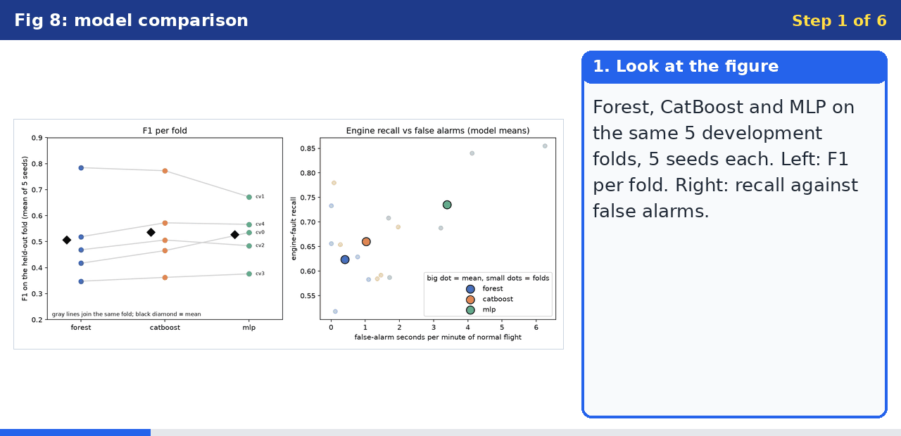 | 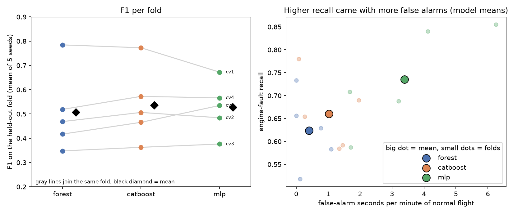 |

**Formula**

- Each model and fold was trained with 5 seeds. One dot = the mean of the 5 seeds for that fold.
- Left panel: F1 on the held-out fold = 2 * precision * recall / (precision + recall). The diamond is the mean of the five fold values. Means: forest 0.51, CatBoost 0.54, MLP 0.53.
- Right panel: x = false-alarm seconds per minute of normal flight = FP / (number of normal seconds / 60). y = engine-fault recall. The big dot is the mean over folds.
- Threshold 0.5 and 3 seconds in a row for every model.

**Code that produces the numbers** (10_comparison_figure.py, reading results/model_comparison.csv written by 09)

```python
out = pd.read_csv(os.path.join("results", "model_comparison.csv"))
fm = out.groupby(["model", "fold"])[["f1", "rec_eng", "fa_s_per_min"]].mean().reset_index()
f1 = fm.pivot(index="fold", columns="model", values="f1")[models]
ax1.scatter(i - 0.17, f1[m].mean(), marker="D")          # diamond = mean over folds
ax2.scatter(d["fa_s_per_min"].mean(), d["rec_eng"].mean())   # big dot
```

#### Fig9: calibration

*Figure 9 is not committed to the repository yet. It is produced by src/15_calibration.py.*

**Formula**

- Scores of one model are put into 10 equal-width bins from 0 to 1. For each non-empty bin, x = the mean score of the bin and y = the share of its seconds with label 1.
- A model whose scores can be read as probabilities lies on the dashed diagonal.
- Brier score = the mean of (p_t - y_t)^2 over all rows. Always guessing the fault share pi gives pi * (1 - pi), which is about 0.13 here.
- The script reads seed 0 of results/oof_models.csv. The figure is not committed to the repository yet.

**Code that produces the numbers** (15_calibration.py)

```python
oof = pd.read_csv(os.path.join("results", "oof_models.csv"))
oof = oof[oof["seed"] == 0]
for model in ["forest", "catboost", "mlp"]:
    d = oof[oof["model"] == model]
    y, p = d["label"].to_numpy(), d["proba"].to_numpy()
    frac, mean_p = calibration_curve(y, p, n_bins=10, strategy="uniform")
    brier = brier_score_loss(y, p)
    ax.plot(mean_p, frac, marker="o", label=f"{model} (Brier {brier:.3f})")
```

### The result tables in the README

| Result | How it is computed | Script |
|---|---|---|
| Model comparison: F1 0.51, 0.54, 0.53 and false alarms 0.40, 1.02, 3.39 per minute for the forest, CatBoost and MLP | The mean over the 5 folds, then over the 5 seeds, of the metrics in the Metric formulas section, at threshold 0.5 and 3 in a row | 09 |
| Conformal threshold | For a held-out fold, take the scores of the normal seconds in the other folds, n of them. Level = min(1, ceil((n + 1) * (1 - alpha)) / n). The threshold is that quantile of the scores (method higher). A raw alarm is a score strictly above it. The false-alarm rate checked is the share of normal seconds in the held-out fold that raise a raw alarm | 12, 13 |
| Permutation importance | The drop in average precision on a held-out fold when one feature's values are shuffled, averaged over 10 shuffles and 5 folds (seed 0). For the altitude pair, the three alt_error columns and the three hud_altitude columns are shuffled together with the same row order | 16 |
| Learning curve | Train on a random share (25, 50, 75 or 100 percent) of the training flights, at least 3 flights, 3 random draws per fold. Whole flights are drawn, not rows. Score AP and F1 on the held-out fold, then average over folds and draws | 17 |
| Chance level and random guess | Always outputting the training fault rate gives AP equal to the fold's share of fault seconds. The random guess draws fault or normal with that rate, 20 draws per fold | 14 |
| Brier of always guessing the share | pi * (1 - pi), where pi is the share of fault seconds (about 0.157), which gives 0.131 | 15 |

### Where the code differs from what we said earlier

While writing this page every script was read again. These points are corrections to earlier explanations, listed so nobody repeats them.

| Earlier statement | What the code does |
|---|---|
| The label warns one second ahead | The label is 1 for the second that contains the fault start and every later second. The first labelled second has a t - phi between -1 and 0 |
| t - phi equals 0 on one row of each flight | phi is usually fractional, so no row has exactly 0. Look for label 1 with t - phi between -1 and 0 |
| A tick left of the black line in fig5 is a false alarm | Only ticks at t - phi of -1 or lower are. A tick between -1 and 0 is in the first labelled second |
| A fig7 cell averages one correlation per flight | The feature and label are shifted by each flight's own mean, then one correlation is taken over all rows of the fault type |
| Fig8 reads oof_models.csv | It reads model_comparison.csv. Fig9 reads oof_models.csv, seed 0 |
| The dual-fault flight has its own type | A name with both rudder and aileron is typed rudder, because rudder is checked first |
| The fig2 title is read from the data | It is typed into 05_figures.py. Check that the first rudder test flight really is the rudder plus aileron flight |
| Scripts 04 and 05 use the same forest as 06 | They add a median imputer in front of the forest. 06 and 09 do not, and the features there have no missing values |

Two smaller points. Normal flights are kept in full by the 30 second cap, and all their rows count in the false alarms per minute. Script 09 writes oof_models.csv before it creates the results folder, so it would fail on a fresh checkout with no results folder.
