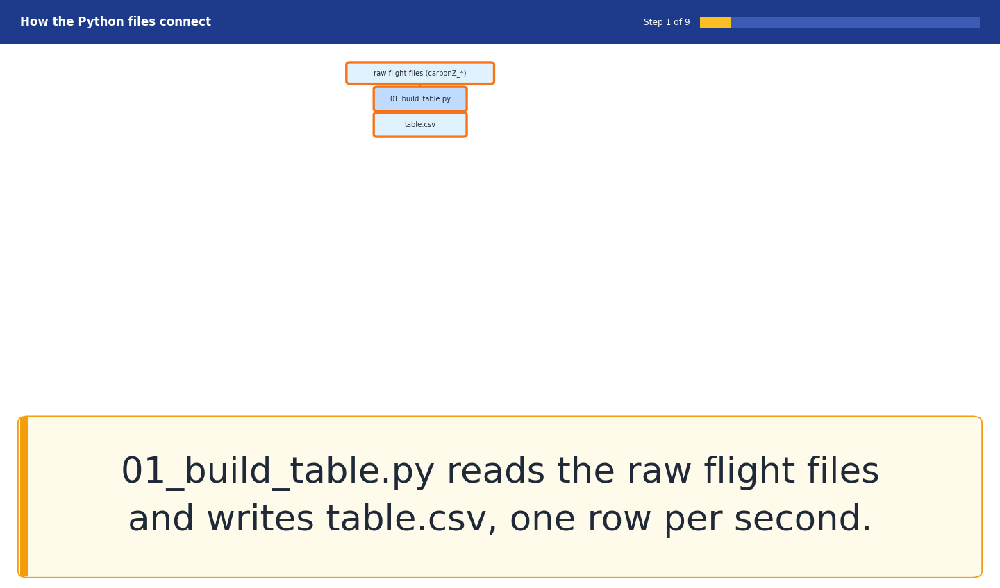
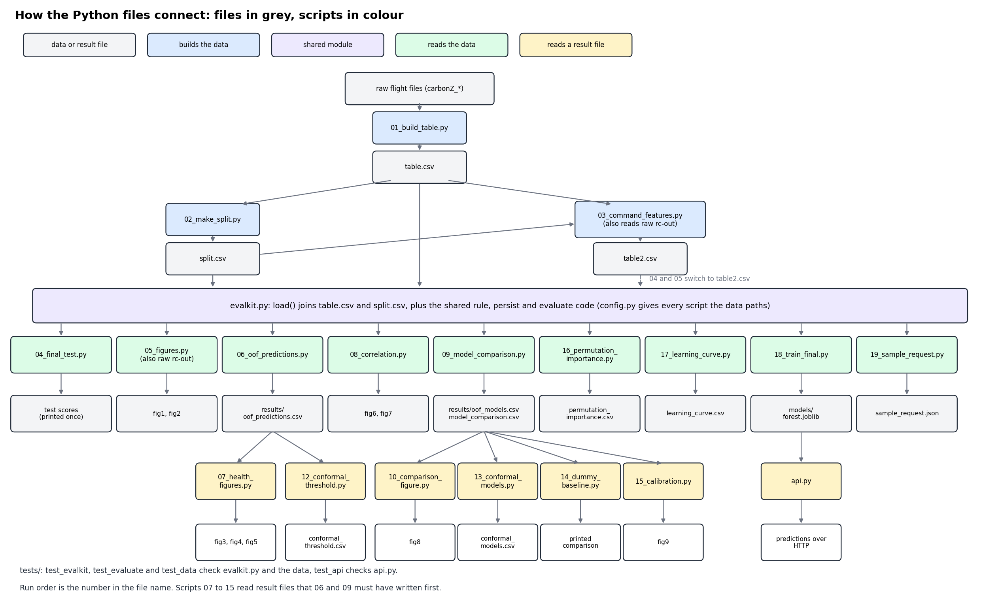

# Code index: where to find each step in the code

Line numbers refer to the repository at the commit that added this file. If a script changes later, the numbers move, so use the function names to search. Names such as `t_rel_fault` and `label` are explained in [ALFA_fault_detection_documentation.md](ALFA_fault_detection_documentation.md).

## Run order and what each script reads and writes

| Step by step | Static picture |
|---|---|
|  |  |

| Step | Script | Reads | Writes |
|---|---|---|---|
| 1 | `src/01_build_table.py` | raw flights in `alfa/processed/processed` | `table.csv` |
| 2 | `src/02_make_split.py` | `table.csv` | `split.csv` |
| 3 | `src/03_command_features.py` | `table.csv`, `split.csv`, raw rc-out files | `table2.csv` |
| 4 | `src/04_final_test.py` | `table2.csv` | prints the locked test result (run once) |
| 5 | `src/05_figures.py` | `table2.csv`, raw rc-out file | `figures/fig1`, `fig2` |
| 6 | `src/06_oof_predictions.py` | `table.csv`, `split.csv` | `results/oof_predictions.csv` |
| 7 | `src/07_health_figures.py` | `results/oof_predictions.csv` | `figures/fig3` to `fig5` |
| 8 | `src/08_correlation.py` | `table.csv`, `split.csv` | `figures/fig6`, `fig7` |
| 9 | `src/09_model_comparison.py` | `table.csv`, `split.csv` | `results/oof_models.csv`, `results/model_comparison.csv` |
| 10 | `src/10_comparison_figure.py` | `results/model_comparison.csv` | `figures/fig8` |
| 11 | `src/12_conformal_threshold.py`, `13_conformal_models.py` | `results/oof_*.csv` | printed tables |
| 12 | `src/14_dummy_baseline.py`, `15_calibration.py`, `16_permutation_importance.py`, `17_learning_curve.py` | results files or the table | printed tables, `figures/fig9` |
| 13 | `src/18_train_final.py` | `table.csv`, `split.csv` | `models/forest.joblib` |
| 14 | `src/api.py`, `src/19_sample_request.py` | `models/forest.joblib` | the demo service and a sample request |

## Shared code

| File and lines | What it does |
|---|---|
| `src/config.py` 4 to 5 | `PROJECT` is the repository folder. `DATA` is the `ALFA_DATA` environment variable, or `data` inside the project |
| `src/evalkit.py` 8 to 12 | `load(cap=30)`: merge the table with the split roles, drop rows more than 30 s after the fault |
| `src/evalkit.py` 14 to 17 | `feature_lists`: every column with two underscores is a feature, `cause_` columns are separate |
| `src/evalkit.py` 19 to 23 | `f1_of`: F1 from true positives, false positives and false negatives |
| `src/evalkit.py` 25 to 36 | `fit_rule`: try each feature, 49 quantile thresholds and both directions, keep the best F1 (line 30 builds the thresholds) |
| `src/evalkit.py` 38 to 41 | `apply_rule`: turn a rule into 0 and 1 per row |
| `src/evalkit.py` 46 to 49 | `persist`: 3 alarms in a row inside one flight (rolling minimum, line 48) |
| `src/evalkit.py` 51 to 83 | `evaluate`: precision, recall, F1, engine recall (line 66), false alarms per minute (line 68), median delay (lines 69 to 81) |

## Step by step

| Step | File and lines | What happens |
|---|---|---|
| Wrap angle difference | `src/01_build_table.py` 11 to 12 | `wrap(x) = (x + 180) % 360 - 180` |
| Ten signals | `src/01_build_table.py` 20 to 31 | `SIGNALS`: topic and column of each signal, roll, pitch and yaw as `wrap(measured - commanded)` (line 18) |
| Fault type from the name | `src/01_build_table.py` 33 to 40 | `fault_type(name)` |
| Time base | `src/01_build_table.py` 46 to 48 | first IMU timestamp is `start`, `n` is the number of seconds |
| Fault start | `src/01_build_table.py` 50 to 53 | `fault_sec` from the earliest `failure_status` message |
| Per-second mean | `src/01_build_table.py` 61 to 62 | group readings by second, mean, fill gaps forward up to 5 s |
| Features | `src/01_build_table.py` 64 to 66 | `mean5`, `std5` (sample standard deviation), `delta10` |
| Label | `src/01_build_table.py` 75 to 80 | `label = (t + 1 > fault_sec)`, `t_rel_fault = t - fault_sec` |
| Drop the first 10 s | `src/01_build_table.py` 84 | rows with `t < 10` are removed |
| Session assignment | `src/02_make_split.py` 7 to 38 | the `ASSIGN` dictionary: session to `cv0`..`cv4` or `test` |
| Session never split | `src/02_make_split.py` 40 to 66 | checks per group and per fault type |
| Frozen channel | `src/03_command_features.py` 22 to 26 | per-second standard deviation with `ddof=0`, frozen when it is 0, 3 seconds in a row |
| Any frozen channel | `src/03_command_features.py` 30 to 31 | `cmd_frozen_any` is the maximum over channels |
| Detector A | `src/04_final_test.py` 21 to 22 | `fit_rule` on development rows, then `persist(..., 3)` |
| Detector F | `src/04_final_test.py` 24 to 28 | random forest, 300 trees, threshold 0.5, `persist(..., 3)` |
| Detector D2 | `src/04_final_test.py` 29 to 33 | frozen channel or a throttle rule |
| Fig1 data | `src/05_figures.py` 25 to 61 | rules, forest, one engine test flight |
| Fig2 data | `src/05_figures.py` 63 to 79 | raw rc-out channels around the fault (the title text is typed in, line 76) |
| Out-of-fold forest | `src/06_oof_predictions.py` 12 to 23 | train on four folds, predict the fifth, then `persist` |
| Fig3 recall | `src/07_health_figures.py` 15 to 38 | share of fault seconds with an alarm, per fault type |
| Fig4 confusion matrix | `src/07_health_figures.py` 41 to 51 | `normalize="true"` |
| Fig5 timeline | `src/07_health_figures.py` 53 to 74 | one row per fault flight |
| Within-flight correlation | `src/08_correlation.py` 18 to 22 | subtract each flight's mean, then `corrwith` the label (fig7 numbers) |
| Fig7 heatmap | `src/08_correlation.py` 55 to 70 | colour scale cut at -0.6 and 0.6 |
| Fig6 heatmap | `src/08_correlation.py` 40 to 51 and 72 to 83 | ordinary correlation of the 21 features, pairs above 0.9 printed |
| Three models | `src/09_model_comparison.py` 29 to 65 | forest, CatBoost, small Keras network |
| Seeds and folds loop | `src/09_model_comparison.py` 73 to 94 | 5 seeds, writes the two results files |
| Fig8 | `src/10_comparison_figure.py` 6 to 47 | mean of 5 seeds per model and fold |
| Conformal threshold | `src/12_conformal_threshold.py` 20 to 23 | `level = min(1, ceil((n + 1) * (1 - alpha)) / n)`, quantile with method `higher` |
| Dummy baselines | `src/14_dummy_baseline.py` 20 to 39 | prior and stratified guesses |
| Calibration | `src/15_calibration.py` 21 to 32 | 10 bins, Brier score |
| Permutation importance | `src/16_permutation_importance.py` 29 to 37 | drop in average precision when columns are shuffled together |
| Learning curve | `src/17_learning_curve.py` 12 to 47 | whole flights drawn at 25, 50, 75 and 100 percent |
| Final model | `src/18_train_final.py` 17 to 25 | forest trained on all development flights, saved with `joblib.dump` |
| API | `src/api.py` 25 to 73 | `load_bundle` (25), `persistent_alarm` (32), `/health` (46), `/predict` (53) |

## Tests

| File | Tests |
|---|---|
| `tests/test_evalkit.py` | persistence rule, feature lists |
| `tests/test_evaluate.py` | clean detection, false alarm before the fault, delay, engine versus other types |
| `tests/test_data.py` | row counts, flight counts, cap at 30 s, no flight in two roles (these need the data) |
| `tests/test_api.py` | health, reply shape, missing features, thresholds, persistence rule |
